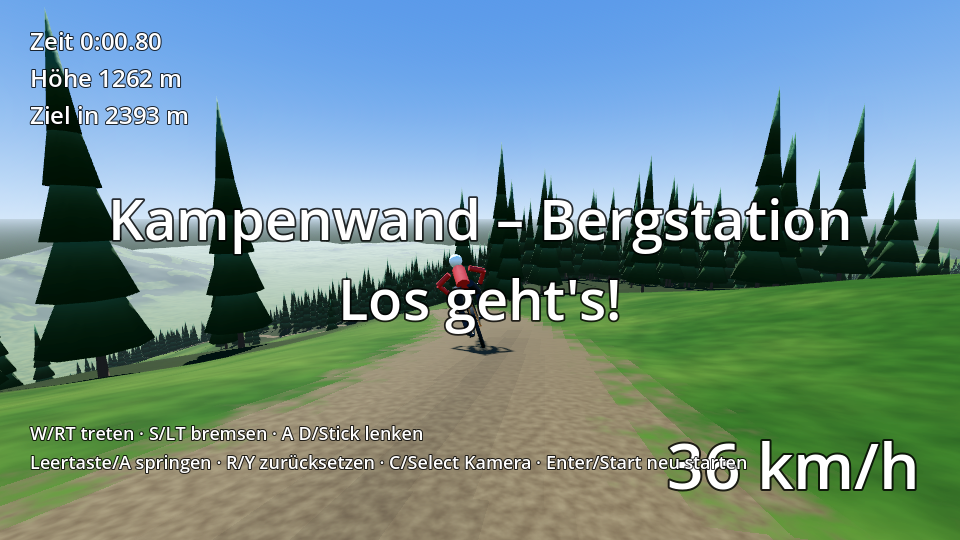

# Kampenwand Race

Downhill-Mountainbike-Rennspiel im Stil von *Downhill Domination*: Abfahrt von der Bergstation der
Kampenwandbahn (ca. 1.440 m) bis zur Talstation in Aschau (ca. 620 m), gebaut mit **Godot 4.5**.



## Spielen

1. [Godot 4.5](https://godotengine.org/download) herunterladen (die normale Version, nicht .NET).
2. Godot starten, **Importieren** wählen und `game/project.godot` öffnen.
3. Mit **F5** starten.

| Aktion | Tastatur | Gamepad |
|---|---|---|
| Lenken | A / D oder Pfeiltasten | linker Stick |
| Treten | W / Pfeil hoch | rechter Trigger |
| Bremsen | S / Pfeil runter | linker Trigger |
| Springen (Bunny Hop) | Leertaste | A |
| Zurück auf die Strecke | R | Y |
| Kamera (Verfolger / Helm) | C | Select |
| Neu starten | Enter | Start |

## Stand (Schritt 1 von 4)

- **Gelände** aus echten Höhendaten, 2-m-Raster um die Strecke und 8-m-Raster für die Fernsicht (16 × 16 km).
  Ein mitwanderndes Gitter, dessen Höhe im Shader berechnet wird, zeigt das ganze Gebiet in einem Durchgang.
- **Strecke** 2,8 km, rund 815 Höhenmeter, als Trail ins Gelände gefräst.
- **Fichtenwald** entlang der Strecke (Baumgrenze ca. 1.480 m), Bäume sind Hindernisse.
- **Fahrphysik**: Hangabtrieb, Luft- und Rollwiderstand je Untergrund (Trail, Wiese, Wald), Haftgrenze in
  Kurven, Schräglage, Sprünge, Stürze bei harter oder schräger Landung und an Bäumen.
- Verfolger- und Helmkamera, HUD mit Zeit, Tempo, Höhe und Restdistanz.

## Geländedaten

`tools/build_terrain.py` erzeugt die Dateien in `game/data/` neu (`pip install numpy pillow scipy`):

```
python3 tools/build_terrain.py
```

Quelle sind momentan die [AWS Terrain Tiles](https://registry.opendata.aws/terrain-tiles/) (für diese
Gegend etwa 30-m-Genauigkeit, der Gipfel kommt dort nur auf ca. 1.600 m statt 1.669 m). Feinere Details
entstehen durch Glättung und Rauschen. Geplant ist der Umstieg auf das
[DGM1 Bayern](https://geodaten.bayern.de/opengeodata/OpenDataDetail.html?pn=dgm1) (1 m, CC BY 4.0).
Die Streckenlinie stammt aus `tools/downhill_linie.geojson`.

## Testlauf ohne Spieler

```
godot --headless --path game -- --autotest   # Bot fährt die Strecke, Protokoll auf der Konsole
godot --path game -- --shots                 # Standbilder entlang der Strecke nach user://shots/
```

## Fahrplan

1. ~~Berg und Fahrphysik~~
2. Strecke und Rennen: Checkpoints, Countdown, Platzierungen, 3–5 KI-Fahrer
3. Grafik und Atmosphäre: Vegetation, Felsen, Wahrzeichen (Gipfelkreuz, Steinlingalm, Seilbahn), Sound
4. Menü, HUD und Windows-Version
